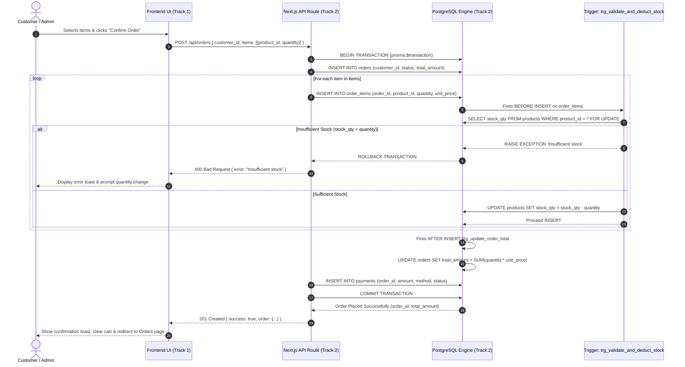
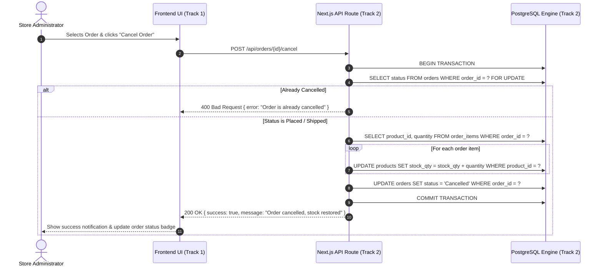
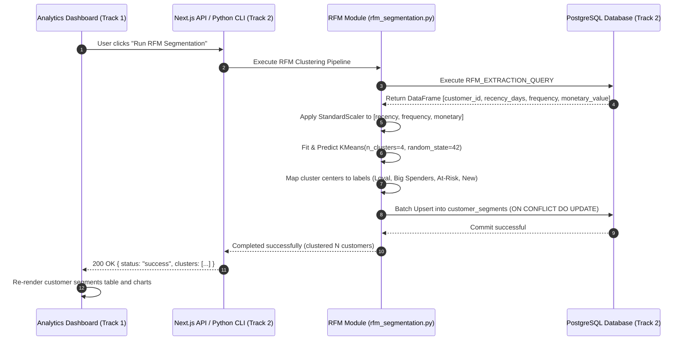

# System Architecture & Technical Design Document

**Project**: E-Commerce Database Management System  
**Document Version**: 1.0.0  
**Target Systems**: PostgreSQL 14+, Prisma ORM v6, Next.js 16 App Router, Python ML Scikit-Learn  

---

## 1. System Overview

The **E-Commerce Database Management System** is a robust, academic-grade enterprise platform engineered to enforce strict database consistency, prevent inventory overselling, maintain immutable audit ledgers, and derive actionable marketing intelligence through unsupervised machine learning.

The architecture adopts a decoupled, multi-tier topology where business rules and transactional integrity are enforced directly inside the **PostgreSQL relational engine**, while modern web and analytics layers interface through type-safe ORM and REST protocols.

---

## 2. High-Level Architectural Topology

```mermaid
flowchart TD
    subgraph Client_Layer ["Client & Presentation Layer (Track 1: Frontend)"]
        UI_STORE["Customer Storefront & Catalog (Next.js App)"]
        UI_CART["Interactive Cart & Atomic Checkout Modal"]
        UI_ORDERS["Order Management & Cancellation Console"]
        UI_ANALYTICS["Executive Analytics & RFM Dashboard"]
    end

    subgraph API_Layer ["Application & API Layer (Track 2: Backend)"]
        API_NEXT["Next.js Route Handlers (/api/*)"]
        API_EXPRESS["Express REST Server (src/server.js)"]
        PRISMA_CLIENT["Prisma ORM Client (Singleton Instance)"]
    end

    subgraph ML_Layer ["Machine Learning & Analytics Engine (Track 2: Backend)"]
        SQL_EXTRACTOR["RFM SQL Extractor (Window Functions & Date Math)"]
        SCALER["StandardScaler Feature Normalization"]
        KMEANS["K-Means Clustering Engine (k=4)"]
        UPSERT_SYNC["Database Synchronization Pipeline"]
    end

    subgraph Database_Layer ["PostgreSQL Database Engine (3NF Relational Layer)"]
        subgraph Tables ["Relational Tables"]
            T_CAT["categories"]
            T_PROD["products"]
            T_CUST["customers"]
            T_CART["carts"]
            T_CART_ITEM["cart_items"]
            T_ORD["orders"]
            T_ORD_ITEM["order_items"]
            T_PAY["payments"]
            T_REV["reviews"]
            T_SEG["customer_segments"]
        end

        subgraph Engine_Logic ["Engine-Level Routines & Triggers"]
            TRG_STOCK["trg_validate_and_deduct_stock (BEFORE INSERT)"]
            TRG_TOTAL["trg_update_order_total (AFTER INSERT/UPDATE/DELETE)"]
            PROC_ORDER["place_order(customer_id, items)"]
            PROC_CANCEL["cancel_order(order_id)"]
            FN_SPEND["get_customer_total_spent(customer_id)"]
        end
    end

    %% Connections
    UI_STORE -->|HTTP JSON| API_NEXT
    UI_CART -->|HTTP JSON| API_NEXT
    UI_ORDERS -->|HTTP JSON| API_NEXT
    UI_ANALYTICS -->|HTTP JSON| API_NEXT

    API_NEXT --> PRISMA_CLIENT
    API_EXPRESS --> PRISMA_CLIENT
    PRISMA_CLIENT -->|Type-safe SQL / Connection Pool| Database_Layer

    SQL_EXTRACTOR -->|Direct psycopg2 Query| Database_Layer
    SQL_EXTRACTOR --> SCALER --> KMEANS --> UPSERT_SYNC
    UPSERT_SYNC -->|Batch Upsert into customer_segments| T_SEG

    T_ORD_ITEM --> TRG_STOCK
    T_ORD_ITEM --> TRG_TOTAL
    TRG_STOCK -->|Row-lock & Decrement| T_PROD
    TRG_TOTAL -->|Recalculate & Update| T_ORD
```

---

## 3. Core Architectural Subsystems

### 3.1 Presentation Tier (Track 1: Frontend)
- **Framework**: Next.js 16 (App Router), React 19, TypeScript.
- **Styling**: Tailwind CSS with custom responsive layout and dark/light color palette.
- **Icons**: Lucide React for consistent vector iconography.
- **Core Responsibilities**:
  1. Render dynamic catalog with real-time stock status (In Stock, Low Stock $\le 5$, Out of Stock).
  2. Maintain persistent client-side cart state and execute modal-driven checkout.
  3. Provide interactive order cancellation with immediate inventory restoration feedback.
  4. Present RFM segment clustering with visual badge distribution and customer search.
  5. Invoke 1-click database initialization and seed reset with feedback banners.

### 3.2 Application & Data-Access Tier (Track 2: Backend)
- **Runtime**: Node.js v20+ / Next.js Serverless Route Handlers + Standalone Express 5 server.
- **ORM**: Prisma ORM v6 with schema mapping (`schema.prisma`).
- **Core Responsibilities**:
  1. Manage database connections with connection pooling (`src/lib/prisma.ts`).
  2. Expose RESTful API endpoints with validation, parameter parsing, and HTTP status codes.
  3. Execute multi-table transactional workflows via `prisma.$transaction`.
  4. Translate client requests into validated queries and format database results into standardized JSON responses.

### 3.3 Relational Database Engine (Track 2: Backend)
- **Database Engine**: PostgreSQL 14 / 16 (containerized via Alpine Linux).
- **Relational Standard**: Strict adherence to **Third Normal Form (3NF)**.
- **Core Responsibilities**:
  1. Enforce primary keys, foreign key constraints, unique constraints, and check constraints at the storage engine level.
  2. Implement concurrency control using row-level locking (`SELECT FOR UPDATE`) inside triggers to avoid race conditions and overselling.
  3. Provide stored procedures for business operations (`place_order`, `cancel_order`) and stored functions for reporting (`get_customer_total_spent`).
  4. Optimize queries with B-tree indexing across primary keys, foreign keys, and filtering columns.

### 3.4 Machine Learning Analytics Subsystem (Track 2: Backend)
- **Runtime & Libraries**: Python 3.10+, Scikit-learn, Pandas, NumPy, psycopg2.
- **Core Responsibilities**:
  1. Extract behavioral features (Recency, Frequency, Monetary) per customer via an optimized SQL query utilizing date arithmetic and aggregate windowing.
  2. Normalize continuous features using `StandardScaler` to prevent feature dominance.
  3. Train a $K$-Means clustering model with $k=4$.
  4. Dynamically assign business-interpretable labels:
     - **Loyal Customers**: Low recency (frequent recent visits), high frequency, moderate/high spend.
     - **Big Spenders**: Highest monetary value, moderate to high frequency.
     - **At-Risk Customers**: High recency (long inactivity), previously active.
     - **New Customers**: Low recency, low frequency, low monetary value.
  5. Upsert results into `customer_segments` for consumption by the frontend dashboard.

---

## 4. Key Transactional Data Flows

### 4.1 Order Placement & Stock Validation Flow (ACID Atomic Transaction)

---

### 4.2 Order Cancellation & Inventory Restoration Flow

---

### 4.3 Machine Learning Pipeline Flow

---

## 5. Third Normal Form (3NF) Validation

The database schema strictly complies with all relational normalization criteria:

| Normal Form | Rule | Project Implementation |
|---|---|---|
| **1NF (First Normal Form)** | Atomic values; no repeating groups; defined primary keys. | All attributes contain atomic data types (`INT`, `VARCHAR`, `DECIMAL`, `TIMESTAMPTZ`). Line items are resolved into independent rows in `order_items` and `cart_items`. |
| **2NF (Second Normal Form)** | 1NF satisfied + no partial key dependencies on candidate keys. | Composite keys (e.g., `(order_id, product_id)` in `order_items`) only determine attributes specific to that pair (`quantity`, `unit_price`). Product descriptions are kept in `products`, not `order_items`. |
| **3NF (Third Normal Form)** | 2NF satisfied + no transitive dependencies (non-key attributes depend only on the primary key). | Product `category_name` is stored in `categories` rather than `products`. Customer information (`email`, `city`) is stored in `customers` rather than `orders`. Order totals are verified and stored via automated triggers. |

---

## 6. Non-Functional Requirements & System Guarantees

1. **Transaction Atomicity (ACID)**:
   - Order placement, line-item insertion, inventory deduction, and payment creation must succeed together or fail together.
2. **Concurrency Safety**:
   - Explicit `SELECT ... FOR UPDATE` locking prevents two concurrent checkout requests from deducting inventory below zero.
3. **Auditability & Historic Data Integrity**:
   - `order_items.unit_price` stores the price locked at the time of purchase. Future changes to `products.price` never alter historical order amounts or financial reports.
4. **Performance**:
   - B-tree indexing on foreign keys (`orders.customer_id`, `order_items.product_id`, etc.) guarantees $O(\log N)$ join performance.
   - Database connection pooling prevents connection starvation under high concurrency.
