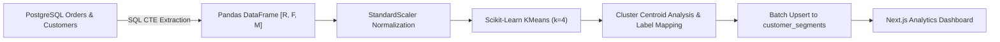

# Machine Learning RFM Customer Segmentation Specification

**Algorithm**: $K$-Means Clustering ($k=4$) with Feature Standardization  
**Library Stack**: Scikit-Learn, Pandas, NumPy, psycopg2  
**Target Relational Table**: `customer_segments`  
**Integration**: Connected to PostgreSQL 3NF schema and visualized in Next.js Analytics Dashboard  

---

## 1. Business & Academic Context

Online retailers require quantitative customer segmentation to target promotional campaigns, prevent churn, and reward top-tier customers. Traditional manual segmentation based on arbitrary thresholds fails to adapt to changing purchasing distributions.

This system integrates an **Unsupervised Machine Learning pipeline** directly with the transactional database to extract **Recency, Frequency, and Monetary (RFM)** behavior metrics and cluster customers using the $K$-Means algorithm.

---

## 2. Mathematical Definition of RFM Metrics

For each registered customer $c_i \in C$:

1. **Recency ($R_i$)**:
   The number of days elapsed between the reference snapshot date ($T_{snapshot}$) and the customer's most recent valid order date ($T_{last\_order}$):
   $$R_i = \left\lfloor \frac{T_{snapshot} - \max(T_{order, i})}{86400} \right\rfloor$$
   *If a customer has placed no orders, recency defaults to elapsed days since account creation (`join_date`).*

2. **Frequency ($F_i$)**:
   The total count of distinct, non-cancelled orders placed by customer $c_i$:
   $$F_i = \sum_{o \in Orders_i} \mathbb{I}(\text{status}_o \neq \text{'Cancelled'})$$

3. **Monetary Value ($M_i$)**:
   The total cumulative expenditure across all non-cancelled orders:
   $$M_i = \sum_{o \in Orders_i, \text{status}_o \neq \text{'Cancelled'}} \text{total\_amount}_o$$

---

## 3. SQL Feature Extraction Pipeline

The feature extraction query runs natively against PostgreSQL to avoid transferring full transaction logs to Python:

```sql
WITH snapshot_ref AS (
    SELECT COALESCE(MAX(order_date), CURRENT_TIMESTAMP) + INTERVAL '1 day' AS snapshot_date
    FROM orders
),
customer_orders AS (
    SELECT
        c.customer_id,
        c.customer_name,
        c.email,
        c.city,
        COALESCE(
            ROUND(EXTRACT(EPOCH FROM (ref.snapshot_date - MAX(o.order_date))) / 86400),
            ROUND(EXTRACT(EPOCH FROM (ref.snapshot_date - c.join_date)) / 86400)
        )::INT AS recency_days,
        COUNT(DISTINCT CASE WHEN o.status != 'Cancelled' THEN o.order_id END)::INT AS frequency,
        COALESCE(
            SUM(CASE WHEN o.status != 'Cancelled' THEN o.total_amount ELSE 0 END),
            0.00
        )::NUMERIC(12, 2) AS monetary_value
    FROM customers c
    CROSS JOIN snapshot_ref ref
    LEFT JOIN orders o ON c.customer_id = o.customer_id
    GROUP BY c.customer_id, c.customer_name, c.email, c.city, c.join_date, ref.snapshot_date
)
SELECT * FROM customer_orders;
```

---

## 4. Machine Learning Pipeline Architecture



### 4.1 Feature Normalization (`StandardScaler`)
Because Recency (days: $0 \dots 365$), Frequency (counts: $0 \dots 50$), and Monetary (currency: $\$0 \dots \$10,000+$) operate on vastly different numerical scales, running Euclidean-distance-based clustering without scaling would cause the Monetary feature to dominate the distance calculation.

Each feature $x$ is normalized using:
$$z = \frac{x - \mu}{\sigma}$$
where $\mu$ is the feature mean and $\sigma$ is the standard deviation.

### 4.2 $K$-Means Objective Function
The algorithm partitions $N$ customer observations into $k=4$ clusters $S = \{S_1, S_2, S_3, S_4\}$ by minimizing the Within-Cluster Sum of Squares (Inertia):
$$\arg\min_S \sum_{j=1}^{4} \sum_{x \in S_j} \| x - \mu_j \|^2$$
where $\mu_j$ is the centroid of cluster $S_j$.

### 4.3 Business Segment Mapping Rules
After clustering converges, cluster centroids are inspected across the unscaled $R, F, M$ dimensions and mapped into business labels:

| Segment Label | Behavioral Profile | Recency | Frequency | Monetary Value | Business Action |
|---|---|---|---|---|---|
| **Loyal Customers** | High engagement, repeat purchasers | Low ($< 30$ days) | High ($> 5$ orders) | Moderate to High | VIP loyalty perks, early product access |
| **Big Spenders** | High transaction value | Low to Mid | Moderate | Highest total spend | High-ticket upselling, concierge support |
| **At-Risk Customers** | Inactive, historical purchasers | High ($> 90$ days) | Low to Moderate | Any | Win-back discount coupons, re-engagement emails |
| **New Customers** | Recent first-time or zero-order accounts | Very Low ($< 15$ days) | Low ($1$ order) | Low | Onboarding guides, second-purchase discount |

---

## 5. Database Synchronization (`customer_segments`)

Once labels are assigned, the pipeline issues an idempotent SQL batch upsert using `execute_values`:

```sql
INSERT INTO customer_segments (
    customer_id,
    recency_days,
    frequency,
    monetary_value,
    segment_label,
    last_updated
) VALUES %s
ON CONFLICT (customer_id) DO UPDATE SET
    recency_days = EXCLUDED.recency_days,
    frequency = EXCLUDED.frequency,
    monetary_value = EXCLUDED.monetary_value,
    segment_label = EXCLUDED.segment_label,
    last_updated = CURRENT_TIMESTAMP;
```

---

## 6. Unit Testing & Validation Protocol (`ml/test_rfm.py`)

The ML pipeline is covered by automated unit tests executed via `pytest`:
1. **Scaler Invariance**: Verifies that standardized features have $\mu \approx 0$ and $\sigma \approx 1$.
2. **Cluster Convergence**: Verifies that $K$-Means assigns exactly 4 unique cluster labels and output matches expected schema.
3. **Empty / Single-order Edge Cases**: Confirms graceful handling when customers have zero orders or identical spending.
4. **Idempotency**: Asserts that consecutive executions with identical input data yield identical cluster label assignments.
